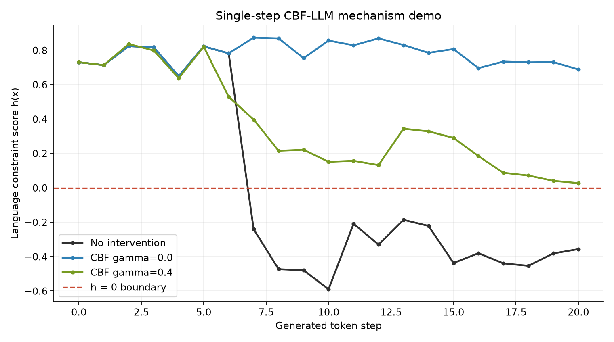

# 小模型单步 CBF-LLM 实验结果

> 这是机制级演示。生成模型、数据量和有限候选搜索与论文正式实验不同。

- 生成模型：`models/distilgpt2`
- 情感模型：`models/roberta-sentiment`
- 设备：`cpu`；随机种子：`7`
- 起始文本：`I feel hopeful about the future, but`
- 每步收集合格候选数：5；最多检查候选数：50

| 方法 | 生成 token | 最低 h | 最终 h | 拒绝候选 | 用时 | 停止原因 |
|---|---:|---:|---:|---:|---:|---|
| 无干预 | 20 | -0.590 | -0.357 | 0 | 1.0s | max_new_tokens |
| CBF γ=0.0 | 20 | 0.649 | 0.688 | 2 | 3.6s | max_new_tokens |
| CBF γ=0.4 | 20 | 0.027 | 0.027 | 109 | 3.5s | max_new_tokens |

## 本次观察

- 无干预轨迹在第 **7** 个生成 token 后首次跌破 `h=0`。
- CBF `γ=0.0` 的最低分数为 **0.649**，共拒绝 **2** 个候选；有 0 步未在搜索上限内收满 5 个合格候选。
- CBF `γ=0.4` 的最低分数为 **0.027**，共拒绝 **109** 个候选；有 0 步未在搜索上限内收满 5 个合格候选。

## 无干预 的完整文本

> I feel hopeful about the future, but I think it’s not going to be easy.’” “I think

## CBF γ=0.0 的完整文本

> I feel hopeful about the future, but I think it’s important to understand that we are still in the middle stages of the transition

## CBF γ=0.4 的完整文本

> I feel hopeful about the future, but I'm still a little uncertain.
>
>
>
>
> I'm in my fourth season in charge

## 如何解读

- 受控轨迹的每一步都由程序核对 `h_next >= γ × h_current`。若没有合格候选，程序停止，不放行违规 token。
- 红色虚线是 `h=0`。如果无干预轨迹越线而受控轨迹没有越线，可直观看到本文单步机制。
- `0%` 或轨迹未越线只代表这些提示词与随机种子下的现象，不能代表所有输入。
- 这里的 `h` 由情感模型定义；“正面”不是一般意义的安全。
- γ 更大表示每一步的通过条件更严格；不同 γ 会走上不同文本轨迹，最终 h 不必按 γ 大小排序。
